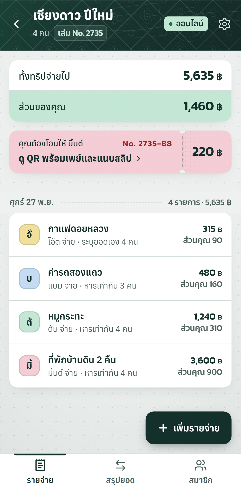
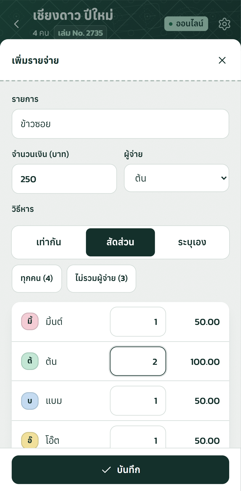
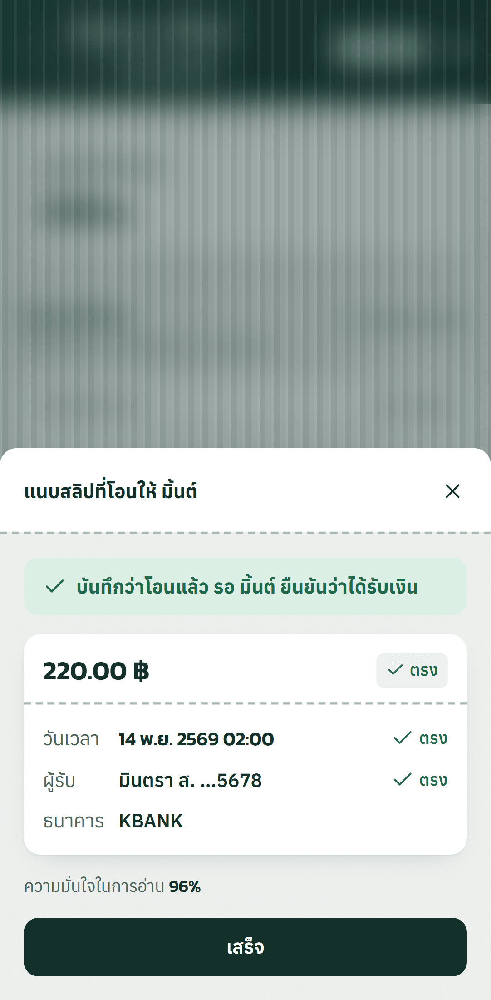
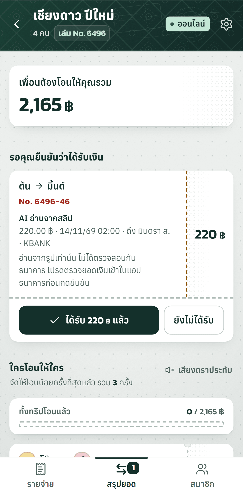
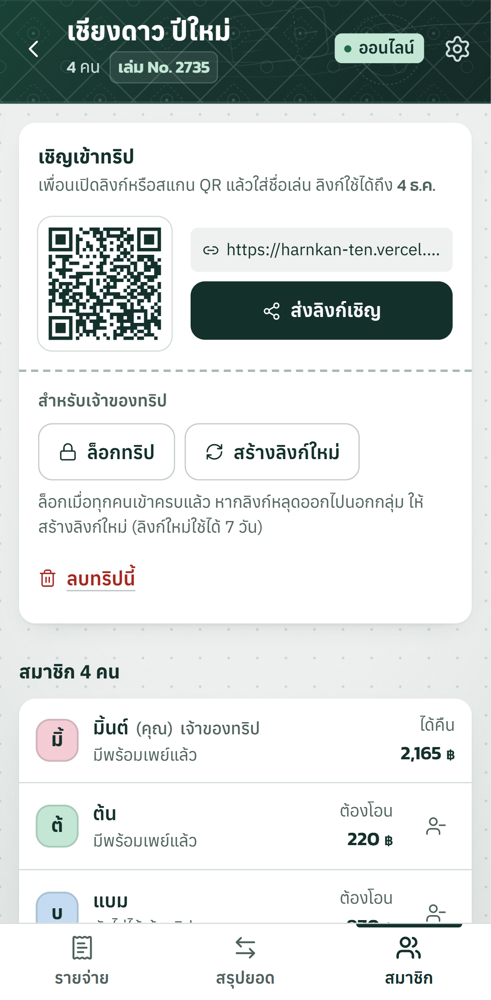
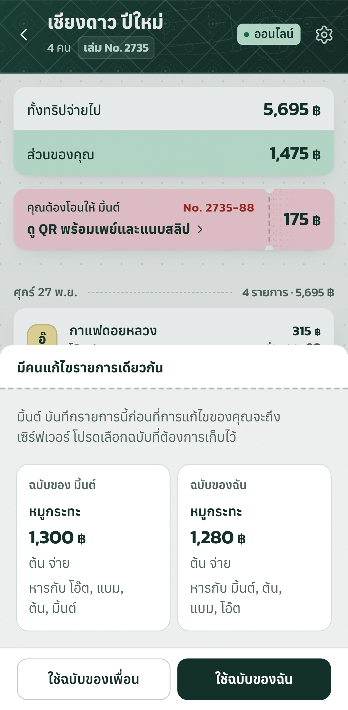
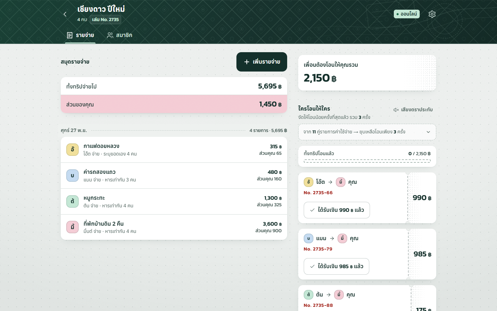

# หารกัน · HarnKan

**Live:** https://harnkan-ten.vercel.app (open it on your phone; "Add to Home Screen" installs it) · **[▶ Watch 16s Feature Showcase (1920×1080)](docs/demo/harnkan-showcase.mp4)**

Split trip costs with friends in real time. Everyone in the group adds expenses from their own phone and sees each other's changes straight away. HarnKan then works out who pays whom using the **fewest possible transfers**. It makes a PromptPay QR with the amount already filled in, and reads the transfer slip to tick the debt as paid. The receiver confirms with one tap.

Thai first: PromptPay QR (EMVCo) and Thai bank slip reading are the parts that overseas splitters like Splitwise don't have.

<table>
<tr><td align="center"><br><sub>Expenses, live for everyone</sub></td><td align="center"><br><sub>Split equally, by weight or exact</sub></td><td align="center"><br><sub>Who pays whom, fewest transfers</sub></td><td align="center"><br><sub>PromptPay QR, amount filled in</sub></td></tr>
<tr><td align="center"><br><sub>Slip read by AI and matched</sub></td><td align="center"><br><sub>Receiver confirms the money</sub></td><td align="center"><br><sub>Invite by link or QR</sub></td><td align="center"><br><sub>Same expense edited twice: pick one</sub></td></tr>
<tr><td colspan="4" align="center"><br><sub>Wide screens: the list beside the settlement</sub></td></tr>
</table>

> The screenshots are generated by `e2e/screenshots.spec.ts` from a demo trip with made-up people.

## What it does

- **No sign-up.** Create a trip, then send a link or QR. Friends type a nickname, or pick a name already added for them (Supabase anonymous auth).
- **Three ways to split:** equal, by weight (1.5 shares and so on), or exact amounts per person. Money is integer satang throughout, so nothing ever ends 1 satang off.
- **Realtime.** Supabase Realtime pushes every change to everyone in the trip.
- **Conflicts are not silently overwritten.** Each expense has a version number. If two people edit the same expense, the second save gets a conflict and sees both versions side by side to pick one. A banner also warns them while they are still editing.
- **Works offline.** It installs as a PWA. A trip opened before still opens with no signal (service worker plus an IndexedDB copy). Changes made offline queue up and sync in order when the connection is back. Replayed creates are idempotent (client-generated UUIDs).
- **Fewest transfers.** See [the algorithm](#settlement-algorithm).
- **PromptPay QR** with the amount filled in, built to the EMVCo spec and tested field by field against `promptpay-qr`.
- **Send the summary to the group.** One tap sends who pays whom, with a link back to the trip, to LINE or any app on the phone's share sheet.
- **Slip reading.** Upload the slip. HarnKan reads the amount, time and receiver, and if they match an outstanding debt it marks it **paid, waiting for the receiver to confirm**. The image is never stored.

## Settlement algorithm

[`src/lib/core/settle.ts`](src/lib/core/settle.ts)

Finding the true minimum number of transfers is NP-hard. With *n* people who owe or are owed, the minimum is *n − k*, where *k* is the largest number of disjoint groups whose balances each sum to zero. HarnKan finds *k* exactly with a DP over subsets (O(2ⁿ·n), instant for n ≤ 16, which covers any real trip) and falls back to greedy above that. The test suite checks it against brute force on 300 random groups and includes a case where greedy needs 4 transfers and the optimum is 3.

Rounding in [`split.ts`](src/lib/core/split.ts) uses the largest-remainder method. Leftover satang go to the payer first, then by member id. The order deliberately doesn't depend on jsonb key order, so every phone computes the same numbers.

## Slip reading

```
slip image ─▶ @harnkan/slip-reader ─▶ { amount, dateTime, receiver{name, last4}, ... , confidence }
                (Gemini vision, or local Thai OCR with no key)
           ─▶ matchSlip(slip, outstanding transfers) ─▶ auto-tick / needs a look
```

- The reader is the workspace package [`packages/slip-reader`](packages/slip-reader), shared with [SlipJot](https://github.com/Vector033/SlipJot). Both apps use the same output contract. It uses Gemini vision (JSON schema) when `GEMINI_API_KEY` is set and tesseract.js Thai OCR otherwise. Rule parsers cross-check the result (Buddhist-era dates, amount text, masked accounts).
- [`slip-match.ts`](src/lib/core/slip-match.ts) decides which debt the slip pays. The amount must match to the satang. The receiver must match by PromptPay last 4 digits or by name. Name matching compares consonant skeletons, because OCR drops Thai vowel and tone marks ("ภานุวัฒน์" → "ภานวัฒน์"). The slip time must fall within the trip, a reused slip reference is refused, and the reader's confidence must be high enough.

**Accuracy** (`npm run eval:match`, 60 synthetic slips in 5 bank layouts with fictional names, local OCR, no API key):

| scenario | result |
|---|---|
| right person, payee name set: auto-ticked | 92% |
| right person, nickname only: auto-ticked | 92% |
| wrong amount: falsely ticked | **0%** |
| wrong person, same amount: falsely ticked | **0%** |
| ticked the wrong member | **0** |

A false tick, where a debt shows as paid when it isn't, is the expensive mistake, so the eval fails if any happen. The remaining 8% go to "needs a look": the date was unreadable or confidence was low, and the user taps once to record it. Field-level reader accuracy is in the SlipJot README. Numbers on real slips and with Gemini are still to come; see the roadmap. To run it on real slips, put the images and a
`labels.json` (amount, time, receiver for each file; see `eval/match.eval.ts`) in `eval/slips-private/`, which git ignores, then
`EVAL_DIR=eval/slips-private EVAL_PROVIDER=gemini npm run eval:match`.

## Security and privacy (PDPA)

Slips are personal data, so the rule is: keep as little as possible, show it only to the trip, and make every boundary enforced by the database rather than the UI.

**What is kept from a slip.** The image only exists in the request's memory: it is read and dropped, never written to disk or the database. What is stored is the amount, time, the receiver's first name and surname initial only (`สมหญิง ด.`), the account's last 4 digits, the bank, and a SHA-256 of the transaction reference salted with the trip id (enough to refuse the same slip twice, useless to look anything up). Uploads are re-encoded in the browser (max 2000 px, which also drops EXIF location data), capped at 4 MB, checked by their file signature rather than their claimed type, and decoded with a 25-megapixel limit. Logs never contain slip content. [`src/lib/core/privacy.ts`](src/lib/core/privacy.ts)

**Who can see and change what** (Postgres RLS + SQL functions, tested in `tests/db`):
- Only members of a trip can read anything in it; every write that needs a check runs in a function.
- Invite links expire after 7 days. The trip creator can **lock** the trip (links stop admitting anyone; a locked preview shows no names), **replace the link** (old links stop working), **remove a member** (they lose access at once, are barred from rejoining with any link, the link is replaced, and their device wipes its cached copy) and **delete the trip**.
- Claiming a name someone added ("I am Ton") waits for the creator's approval, so a stray link cannot be used to become Ton and collect what the group owes Ton.
- A PromptPay number can only be set by its owner. Placeholders cannot carry one, so nobody can point a friend's QR at their own account.
- Payments are claimed by the payer and confirmed only by the receiver; nobody can confirm a payment they recorded, the creator included.
- A payment marked "with slip" can only be written by the server after it read a slip (service role, `record_slip_payment`). Browsers can record manual payments only. When the reading needs the payer's OK, the server hands back an HMAC-signed, 15-minute receipt of exactly what it read, so the browser can confirm it but not edit it.
- Rate limits and bounds: slip reads (20/hour/user), trip creation (20/day/user), members per trip (50), split weights (0–1000, 3 decimals), size caps on stored JSON, and placeholders that appear in an expense cannot be deleted.

**Web.** A per-request nonce CSP (`src/proxy.ts`: scripts only with the nonce, `connect-src` limited to this origin and the Supabase project, `frame-ancestors 'none'`), plus HSTS, `nosniff`, `X-Frame-Options: DENY`, `Referrer-Policy: same-origin` (invite codes live in URLs), a tight `Permissions-Policy` and COOP. The slip API refuses cross-origin posts and oversized bodies.

**On the device.** Trips are cached in IndexedDB for offline use. The home page has "ลบข้อมูลบนเครื่องนี้" for shared phones, and a member who loses access has the cache wiped automatically. A plain-language privacy page lives at `/privacy`.

An independent review (a separate agent with no access to the build context) found the second-pass issues above; each is now covered by a test in `tests/db/rpc.test.ts`.

**Limits, stated honestly.**
- HarnKan does **not** verify slips with a bank; it reads the image and the receiver confirms. The UI says so.
- With `GEMINI_API_KEY` set, slip images are sent to Google for reading. On Gemini's free tier Google may use inputs to improve its products; use a paid key or leave the key unset (local OCR) for real slips.
- Anonymous sign-in has no CAPTCHA yet; Supabase's per-IP limit is the only brake. Adding Cloudflare Turnstile needs keys from the project owner.
- Clearing the browser loses access to trips on that device (anonymous accounts).

## Architecture

| Layer | |
|---|---|
| App | Next.js 16 (App Router) + TypeScript + Tailwind 4, PWA (manifest + hand-written `public/sw.js`). Visual system: Thai food-court coupon booklet (see `DESIGN.md`), Anuphan + Kanit, Lucide icons |
| Data | Supabase Postgres, [one migration](supabase/migrations/20261104000000_init.sql) with RLS and SQL functions for every checked write (`save_expense` with version check, `record_payment` / `decide_payment` with role rules, `validate_split` on the server) |
| Realtime | Supabase Realtime `postgres_changes` filtered per trip; full refetch on every (re)subscribe so no event gap is missed |
| Offline | [`src/lib/trip/store.ts`](src/lib/trip/store.ts): IndexedDB snapshot + ordered outbox, optimistic overlay, coalescing of unsent edits ([`outbox.ts`](src/lib/trip/outbox.ts)) |
| Slips | `POST /api/slips` → `@harnkan/slip-reader` → `matchSlip` → `record_payment` as the user (RLS still applies) |

## Run it locally

Needs Node 24+ and Docker.

```bash
npm install
npm run db:start            # local Supabase on ports 544xx
cp .env.example .env.local  # paste NEXT_PUBLIC_SUPABASE_PUBLISHABLE_KEY from `npx supabase status -o env`
npm run dev
```

Slip reading uses local OCR with no key. Add `GEMINI_API_KEY` to `.env.local` to use Gemini.

## Deploy

Vercel (region `sin1`) + hosted Supabase (Singapore), both close to Thai users.

```bash
npx supabase link --project-ref <ref>
npx supabase db push --remote                                    # schema, RLS, functions
npx supabase config push --workdir deploy --remote=<ref>         # anonymous sign-in, site URL (deploy/supabase/config.toml)
npx vercel env add NEXT_PUBLIC_SUPABASE_URL production           # and NEXT_PUBLIC_SUPABASE_PUBLISHABLE_KEY
npx vercel deploy --prod                                         # or just push to main: Vercel deploys it
E2E_BASE_URL=https://harnkan-ten.vercel.app npx playwright test live   # smoke test on the live site
```

`next.config.ts` lists tesseract.js's worker files for output tracing. Without that, the OCR worker crashes on Vercel because it is started from a file path the tracer cannot follow.

## Google sign-in (optional)

Everyone still starts as a guest (an anonymous Supabase user). On the settings page (`/settings`) a guest with trips can
*link* Google to that same user (`linkIdentity`), so the trips open on any device signed in to that account;
a browser with no trips just signs in. If the Google account already belongs to another user, the guest
session stays and the page asks before switching; if they switch, the guest's trips move into that account
(`/api/merge-guest` checks both sessions, then the service-role function `merge_guest` moves memberships,
ownership and history). The section shows only when `NEXT_PUBLIC_GOOGLE_AUTH=true`.

1. Google Cloud Console → Credentials → OAuth client ID (Web application). Authorised redirect URI:
   `https://<project-ref>.supabase.co/auth/v1/callback`.
2. Supabase dashboard → Authentication → Providers → Google: paste the client ID and secret, enable it.
3. Push the auth config (adds the redirect URLs and turns on manual linking):
   `npx supabase config push --workdir deploy --remote=<project-ref>`.
4. Set `NEXT_PUBLIC_GOOGLE_AUTH=true` in Vercel and redeploy.

Locally the stack has a dummy Google client, so e2e (`e2e/google.spec.ts`) checks the redirect without signing in.

## Settings and defaults

`/settings` holds the account (guest or Google), sign-out of other devices for Google accounts, clearing this
device, and per-person defaults in `public.profiles` (nickname, PromptPay, payee name; RLS: owner only). A trigger
copies the PromptPay fields into the member row whenever a trip is created, joined or a name is claimed, so they are
typed once instead of per trip. There are no passwords to leak.

## Tests

| command | what |
|---|---|
| `npm test` | 120+ unit tests: split rounding, settlement vs brute force, PromptPay vs reference library, slip matching, outbox merge/conflict rules, slip-reader parsers |
| `npm run test:db` | RLS and SQL functions against the local stack: outsiders see nothing, version conflicts, server-side split validation, payment roles, rate limit |
| `npm run test:e2e` | Playwright with 2 browsers: live sync, concurrent edit → conflict dialog, offline add → sync, slip → auto-tick → receiver confirms |
| `npm run build && E2E_PROD=1 npx playwright test pwa` | reload with no network still opens the trip and queues changes |
| `npm run eval:match` | slip matching accuracy (above) |
| `E2E_BASE_URL=… npx playwright test live` | smoke test on a deployed site: 2 phones, realtime, settlement, slip read by server-side OCR |

CI runs all of these except the eval.

## Roadmap

- [x] Deploy (Vercel + hosted Supabase)
- [ ] Use it on a real trip with friends
- [ ] Eval with Gemini and on real, consented, redacted slips (kept outside git)
- [x] Move to another device: link Google to the guest, or sign in to an existing account and bring the trips along
