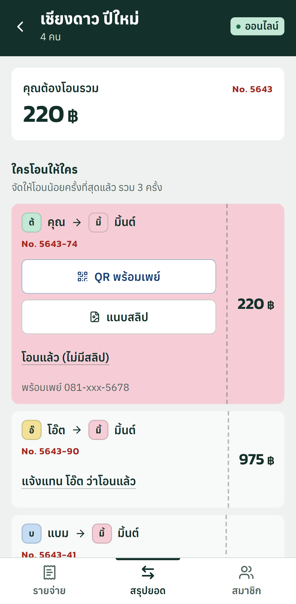
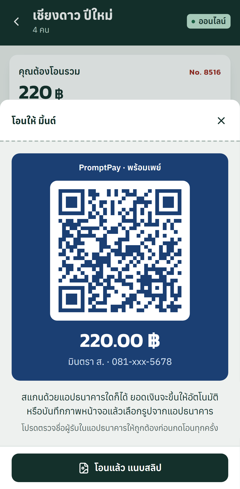

# หารกัน · HarnKan

**Live:** https://harnkan-ten.vercel.app (open it on your phone; "Add to Home Screen" installs it)

Split trip costs with friends in real time. Everyone in the group adds expenses from their own phone and sees each other's changes straight away. HarnKan then works out who pays whom using the **fewest possible transfers**. It makes a PromptPay QR with the amount already filled in, and reads the transfer slip to tick the debt as paid. The receiver confirms with one tap.

Thai first: PromptPay QR (EMVCo) and Thai bank slip reading are the parts that overseas splitters like Splitwise don't have.

<p>




</p>

> The screenshots are generated by `e2e/screenshots.spec.ts` from a demo trip with made-up people.

## What it does

- **No sign-up.** Create a trip, then send a link or QR. Friends type a nickname, or pick a name already added for them (Supabase anonymous auth).
- **Three ways to split:** equal, by weight (1.5 shares and so on), or exact amounts per person. Money is integer satang throughout, so nothing ever ends 1 satang off.
- **Realtime.** Supabase Realtime pushes every change to everyone in the trip.
- **Conflicts are not silently overwritten.** Each expense has a version number. If two people edit the same expense, the second save gets a conflict and sees both versions side by side to pick one. A banner also warns them while they are still editing.
- **Works offline.** It installs as a PWA. A trip opened before still opens with no signal (service worker plus an IndexedDB copy). Changes made offline queue up and sync in order when the connection is back. Replayed creates are idempotent (client-generated UUIDs).
- **Fewest transfers.** See [the algorithm](#settlement-algorithm).
- **PromptPay QR** with the amount filled in, built to the EMVCo spec and tested field by field against `promptpay-qr`.
- **Slip reading.** Upload the slip. HarnKan reads the amount, time and receiver, and if they match an outstanding debt it marks it **paid, waiting for the receiver to confirm**. The image is never stored.

## Settlement algorithm

[`src/lib/core/settle.ts`](src/lib/core/settle.ts)

Finding the true minimum number of transfers is NP-hard. With *n* people who owe or are owed, the minimum is *n − k*, where *k* is the largest number of disjoint groups whose balances each sum to zero. HarnKan finds *k* exactly with a DP over subsets (O(2ⁿ·n), instant for n ≤ 16, which covers any real trip) and falls back to greedy above that. The test suite checks it against brute force on 300 random groups and includes a case where greedy needs 4 transfers and the optimum is 3.

Rounding in [`split.ts`](src/lib/core/split.ts) uses the largest-remainder method. Leftover satang go to the payer first, then by member id. The order deliberately doesn't depend on jsonb key order, so every phone computes the same numbers.

## Slip reading

```
slip image ─▶ @harnkan/slip-reader ─▶ { amount, dateTime, receiver{name, last4}, ... , confidence }
                (Gemini vision, or local Thai OCR with no key)
           ─▶ matchSlip(slip, outstanding transfers) ─▶ auto-tick / needs a look
```

- The reader is the workspace package [`packages/slip-reader`](packages/slip-reader), shared with [SlipJot](https://github.com/Vector033/SlipJot). Both apps use the same output contract. It uses Gemini vision (JSON schema) when `GEMINI_API_KEY` is set and tesseract.js Thai OCR otherwise. Rule parsers cross-check the result (Buddhist-era dates, amount text, masked accounts).
- [`slip-match.ts`](src/lib/core/slip-match.ts) decides which debt the slip pays. The amount must match to the satang. The receiver must match by PromptPay last 4 digits or by name. Name matching compares consonant skeletons, because OCR drops Thai vowel and tone marks ("ภานุวัฒน์" → "ภานวัฒน์"). The slip time must fall within the trip, a reused slip reference is refused, and the reader's confidence must be high enough.

**Accuracy** (`npm run eval:match`, 60 synthetic slips in 5 bank layouts with fictional names, local OCR, no API key):

| scenario | result |
|---|---|
| right person, payee name set: auto-ticked | 92% |
| right person, nickname only: auto-ticked | 92% |
| wrong amount: falsely ticked | **0%** |
| wrong person, same amount: falsely ticked | **0%** |
| ticked the wrong member | **0** |

A false tick, where a debt shows as paid when it isn't, is the expensive mistake, so the eval fails if any happen. The remaining 8% go to "needs a look": the date was unreadable or confidence was low, and the user taps once to record it. Field-level reader accuracy is in the SlipJot README. Numbers on real slips and with Gemini are still to come; see the roadmap.

## Privacy and limits (PDPA)

- **Slip images are never stored.** They live in the request's memory, go to the reader, and are dropped. Only the amount, time, shortened receiver name, last 4 digits and reference are kept.
- **HarnKan does not verify slips with the bank.** It only reads the image. That's why the receiver has to confirm every payment, and the UI says so.
- HarnKan never holds or moves money. It only keeps records and makes QR codes.
- RLS limits each trip to its members. Only you can edit your own PromptPay number, so nobody can point your QR at their account. Slip reads are rate-limited per user to cap API cost.
- Real slips must not be committed. `eval/slips-private/` is gitignored, and the committed fixtures are synthetic.
- Anonymous auth means clearing the browser's cookies loses access on that device. Moving to a new phone is on the roadmap.

## Architecture

| Layer | |
|---|---|
| App | Next.js 16 (App Router) + TypeScript + Tailwind 4, PWA (manifest + hand-written `public/sw.js`) |
| Data | Supabase Postgres, [one migration](supabase/migrations/20261104000000_init.sql) with RLS and SQL functions for every checked write (`save_expense` with version check, `record_payment` / `decide_payment` with role rules, `validate_split` on the server) |
| Realtime | Supabase Realtime `postgres_changes` filtered per trip; full refetch on every (re)subscribe so no event gap is missed |
| Offline | [`src/lib/trip/store.ts`](src/lib/trip/store.ts): IndexedDB snapshot + ordered outbox, optimistic overlay, coalescing of unsent edits ([`outbox.ts`](src/lib/trip/outbox.ts)) |
| Slips | `POST /api/slips` → `@harnkan/slip-reader` → `matchSlip` → `record_payment` as the user (RLS still applies) |

## Run it locally

Needs Node 24+ and Docker.

```bash
npm install
npm run db:start            # local Supabase on ports 544xx
cp .env.example .env.local  # paste NEXT_PUBLIC_SUPABASE_PUBLISHABLE_KEY from `npx supabase status -o env`
npm run dev
```

Slip reading uses local OCR with no key. Add `GEMINI_API_KEY` to `.env.local` to use Gemini.

## Deploy

Vercel (region `sin1`) + hosted Supabase (Singapore), both close to Thai users.

```bash
npx supabase link --project-ref <ref>
npx supabase db push --remote                                    # schema, RLS, functions
npx supabase config push --workdir deploy --remote=<ref>         # anonymous sign-in, site URL (deploy/supabase/config.toml)
npx vercel env add NEXT_PUBLIC_SUPABASE_URL production           # and NEXT_PUBLIC_SUPABASE_PUBLISHABLE_KEY
npx vercel deploy --prod
E2E_BASE_URL=https://harnkan-ten.vercel.app npx playwright test live   # smoke test on the live site
```

`next.config.ts` lists tesseract.js's worker files for output tracing. Without that, the OCR worker crashes on Vercel because it is started from a file path the tracer cannot follow.

## Tests

| command | what |
|---|---|
| `npm test` | 120+ unit tests: split rounding, settlement vs brute force, PromptPay vs reference library, slip matching, outbox merge/conflict rules, slip-reader parsers |
| `npm run test:db` | RLS and SQL functions against the local stack: outsiders see nothing, version conflicts, server-side split validation, payment roles, rate limit |
| `npm run test:e2e` | Playwright with 2 browsers: live sync, concurrent edit → conflict dialog, offline add → sync, slip → auto-tick → receiver confirms |
| `npm run build && E2E_PROD=1 npx playwright test pwa` | reload with no network still opens the trip and queues changes |
| `npm run eval:match` | slip matching accuracy (above) |
| `E2E_BASE_URL=… npx playwright test live` | smoke test on a deployed site: 2 phones, realtime, settlement, slip read by server-side OCR |

CI runs all of these except the eval.

## Roadmap

- [x] Deploy (Vercel + hosted Supabase)
- [ ] Use it on a real trip with friends
- [ ] Eval with Gemini and on real, consented, redacted slips (kept outside git)
- [ ] Move to another device (link an anonymous user to a new phone)
- [ ] Presence ("Bam is editing this item")
